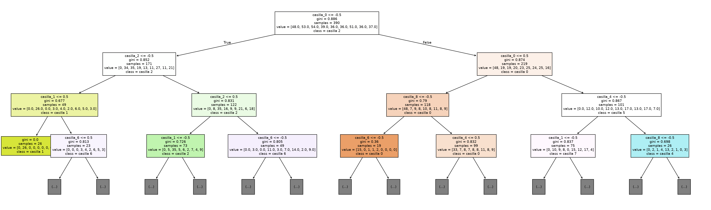

# Tres en Raya: Minimax, Backtracking y Árbol de Decisión

Proyecto educativo de Estructuras de Datos II. Un juego de Tres en Raya
con arquitectura **Modelo-Vista-Controlador (MVC)** donde se comparan dos
formas de tomar decisiones:

- **Minimax con Backtracking:** explora el árbol de jugadas en tiempo real
  y elige siempre una jugada óptima.
- **Árbol de decisión (Machine Learning):** un `DecisionTreeClassifier`
  de Scikit-Learn que aprende a imitar a Minimax a partir de un dataset
  generado con partidas simuladas.

## Modos de juego

1. Humano vs. Humano
2. Humano vs. IA Minimax (muestra nodos explorados y tiempo de respuesta)
3. Humano vs. IA Machine Learning

> La IA juega como **O** y el humano como **X**, que mueve primero.

## Estructura del proyecto

```
proyecto-machine-learning/
├── controller/
│   ├── __init__.py
│   └── game_controller.py   # Conecta la vista con el modelo y los agentes
├── data/
│   ├── arbol_decision.png            # Gráfico del árbol de decisión
│   ├── dataset.csv                   # Dataset generado con Minimax
│   ├── detalle_comparacion.csv       # Resultado por tablero de la comparación
│   ├── reglas_arbol.txt              # Reglas que aprendió el árbol
│   └── resultados_comparacion.txt    # Reporte de la comparación
├── model/
│   ├── __init__.py
│   ├── game_model.py        # Tablero, reglas, victoria y empate
│   ├── minimax_agent.py     # Minimax con Backtracking
│   └── ml_agent.py          # Dataset, entrenamiento e inferencia del árbol
├── view/
│   ├── __init__.py
│   └── gui_view.py          # Interfaz gráfica
├── comparar_agentes.py      # Compara Minimax contra el árbol de decisión
├── entrenar_modelo.py       # Entrena el árbol y exporta sus reglas y gráfico
├── generar_dataset.py       # Simula partidas y crea data/dataset.csv
├── main.py                  # Punto de entrada: inicia el juego
├── README.md
└── requirements.txt         # Dependencias del proyecto
```

## Requisitos

- Python 3
- Las librerías de `requirements.txt`

Se recomienda usar un entorno virtual:

```bash
python -m venv env
```

Actívalo (`env\Scripts\activate` en Windows, `source env/bin/activate` en
Linux o macOS) e instala las dependencias:

```bash
pip install -r requirements.txt
```

## Cómo ejecutarlo

Todos los comandos se ejecutan desde la carpeta `proyecto-machine-learning`,
para que los imports de `model`, `view` y `controller` funcionen.

**1. Generar el dataset.** Simula 1,000 partidas entre Minimax y un jugador
aleatorio, y crea `data/dataset.csv`:

```bash
python generar_dataset.py
```

**2. Entrenar el modelo.** Entrena el árbol de decisión con el dataset y
exporta sus reglas (`data/reglas_arbol.txt`) y su gráfico
(`data/arbol_decision.png`):

```bash
python entrenar_modelo.py
```

**3. Jugar:**

```bash
python main.py
```

**4. Comparar los agentes.** Tarda unos 30 segundos. Imprime el reporte y
lo guarda en `data/resultados_comparacion.txt`, además del detalle de cada
tablero en `data/detalle_comparacion.csv`:

```bash
python comparar_agentes.py
```

## Cómo funciona

1. **Backtracking:** Minimax aplica un movimiento, explora lo que sigue y
   lo deshace (`undo_move`) para probar el siguiente, sin copiar el tablero.
2. **Minimax:** puntúa +10 si gana la IA y -10 si gana el humano, restando
   la profundidad para preferir victorias rápidas y retrasar derrotas.
3. **Dataset:** Minimax juega como O contra un jugador aleatorio. Cada
   decisión se guarda como un tablero de 9 casillas (0 vacía, 1 X, -1 O)
   y la casilla elegida, sin tableros repetidos.
4. **Entrenamiento:** el árbol de decisión aprende a predecir la casilla de
   Minimax a partir del tablero, reemplazando la búsqueda por una consulta.
   Si la predicción cae en una casilla ocupada, la IA juega la primera
   casilla libre.

El árbol completo tiene cientos de nodos, por eso el gráfico muestra solo
sus primeros niveles. Las reglas completas están en `data/reglas_arbol.txt`.



## Resultados de la comparación

Medidos sobre los 2,097 tableros posibles en los que juega O (los tiempos
dependen del equipo):

| | Minimax | Árbol ML |
| --- | --- | --- |
| Tiempo mediano por jugada | 0.13 ms | 1.78 ms |
| Tiempo máximo por jugada | 316.24 ms | 5.64 ms |
| Derrotas en 2,000 partidas | 0 | 21 |

Sobre los tableros que el árbol no vio al entrenar, coincide con Minimax en
el 53% y conserva el resultado teórico en el 75%. En Tres en Raya Minimax
es exacto y casi siempre igual de rápido, porque el árbol de búsqueda es
pequeño. El aprendizaje automático se justifica en juegos donde explorar
todo el árbol es inviable. El análisis completo está en el informe del
proyecto.